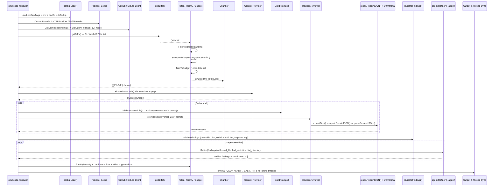
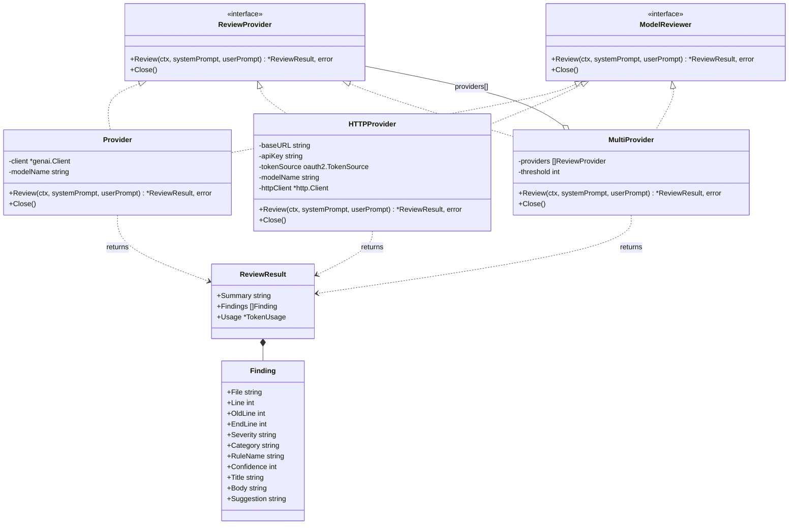
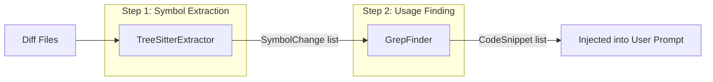
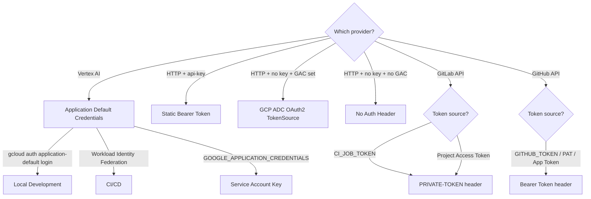

# Architecture Reference

## 1. Overview

**code-reviewer** is an AI-powered code review CLI and library that analyses unified diffs from local Git, GitHub Pull Requests, or GitLab Merge Requests and produces structured, actionable findings. It runs locally against `git diff` or inside GitHub Actions / GitLab CI pipelines, supports multiple AI backends (Vertex AI Gemini/Claude/Mistral, AWS Bedrock via LiteLLM, or any OpenAI-compatible endpoint), and outputs results as colored terminal text, JSON, SARIF 2.1.0, GitLab SAST reports, or inline PR/MR comments with one-click suggestions. A pure-Go tree-sitter context pipeline discovers cross-file regressions, a schema-constrained agent refinement loop (`--agent`) verifies findings against repository source files, and a multi-model consensus mode reduces false positives by requiring agreement across independently queried models.

---

## 2. Pipeline

The following diagram shows the full review pipeline from CLI invocation to output:



---

## 3. Package Map

| Package | Purpose | Key Exported Types | Dependencies |
|---|---|---|---|
| `cmd/code-reviewer` | CLI entry point; wires config, providers, VCS clients, reviewer | `main()`, `run()` | `config`, `context`, `github`, `gitlab`, `model`, `reviewer` |
| `pkg/vcs` | Reusable platform-agnostic VCS types, fingerprinting, and thread state | `MRChanges`, `DiffEntry`, `DiffVersion`, `Comment`, `InlineCommentRequest`, `InlineCommentPosition`, `DismissedFinding`, `OpenFinding`, `Fingerprint()`, `FormatFindingHeader()`, `ParseFindingHeader()` | (stdlib only) |
| `pkg/repair` | Deterministic LLM JSON repair (markdown fence stripping, double-encoded JSON, control characters, unescaped quotes) | `RepairJSON()` | (stdlib only) |
| `pkg/rules` | Custom & platform governance YAML rule schema, validation, and path matching | `Rule`, `File`, `LoadFile()`, `Merge()` | `gopkg.in/yaml.v3` |
| `pkg/agent` | Bounded multi-turn agent loop to verify findings with repository tools | `Refiner`, `Verdict`, `VerdictRecord`, `RunSummary`, `ToolExecutor` | `internal/model` |
| `internal/config` | Config loading and validation; flag/env/YAML/platform merge | `Config`, `Severity`, `CommentMode`, `ChunkStrategy`, `DismissalMode`, `Load()` | `pkg/rules`, `gopkg.in/yaml.v3` |
| `internal/model` | AI model providers, prompt construction, and response parsing | `Provider`, `HTTPProvider`, `MultiProvider`, `ReviewProvider`, `ReviewResult`, `Finding`, `TokenUsage`, `ContextSnippet` | `google.golang.org/genai`, `golang.org/x/oauth2`, `golang.org/x/sync/errgroup`, `pkg/repair`, `internal/retry` |
| `internal/reviewer` | Core review pipeline orchestration, validation, caching, and output | `Reviewer`, `ModelReviewer`, `VCSClient`, `DiffSource`, `CostEstimate`, `AuditEntry` | `pkg/agent`, `pkg/vcs`, `internal/config`, `internal/context`, `internal/diff`, `internal/model` |
| `internal/diff` | Unified diff parsing, filtering, chunking, priority scoring | `FileDiff`, `Hunk`, `DiffLine`, `LineType`, `ChunkStrategy` (interface), `FailStrategy`, `SplitStrategy`, `DiffTooLargeError` | (stdlib only) |
| `internal/context` | Tree-sitter symbol extraction and grep-based usage finding | `Provider` (interface), `DefaultProvider`, `SymbolExtractor`, `UsageFinder`, `SymbolChange`, `CodeSnippet` | `internal/diff`, `github.com/odvcencio/gotreesitter` |
| `internal/gitlab` | GitLab REST API v4 client (notes, discussions, approvals, raw_diffs fallback) | `Client` | `pkg/vcs` |
| `internal/github` | GitHub REST API v3 client (PR reviews, inline comments, thread replies, approvals) | `Client` | `pkg/vcs` |
| `internal/retry` | Exponential backoff with jitter | `Options`, `RetryableError`, `Do()`, `IsRetryable()` | (stdlib only) |

---

## 4. Prompt Layering

The system prompt is constructed by `BuildPromptWithCustom()` in `internal/model/prompt.go` through four additive layers:

```text
┌───────────────────────────────────────────────────┐
│ 1. Base Prompt (built-in or custom file)          │
│    - Persona: "Principal Software Engineer"       │
│    - Objective: thorough, actionable review       │
│    - Critical constraints (line accuracy, tone)   │
│    - Severity guidelines (CRITICAL→LOW)           │
│    - Output format (JSON schema)                  │
│    - Adversarial guardrails (default prompt only)  │
├───────────────────────────────────────────────────┤
│ 2. Focus Overlays (appended per --focus)          │
│    bugs | security | performance | style | docs   │
│    "all" → appends all five in deterministic order│
├───────────────────────────────────────────────────┤
│ 3. Extra Rules (--extra-rules or YAML)            │
│    Appended under "## ADDITIONAL RULES"           │
├───────────────────────────────────────────────────┤
│ 4. Custom Prompt File (--custom-prompt)           │
│    Replaces the base prompt entirely              │
│    Focus overlays and rules still appended        │
└───────────────────────────────────────────────────┘
```

### `BuildPromptWithCustom()` Logic

```go
func BuildPromptWithCustom(customPromptPath string, focusModes []string, extraRules string) string {
    // 1. Base: read custom file or use built-in basePrompt
    // 2. Focus overlays: if "all" or empty, append all 5; else append selected
    // 3. Extra rules: append under "## ADDITIONAL RULES" header
    // Returns: concatenated system prompt string
}
```

### Focus Overlays

| Key | Emphasis |
|---|---|
| `bugs` | Off-by-one, nil derefs, race conditions, error handling |
| `security` | Injection, hardcoded secrets, auth bypass, crypto issues |
| `performance` | N+1 queries, resource leaks, allocations, pagination |
| `style` | Naming, idiomatic patterns, consistency |
| `docs` | Public API docs, outdated comments, complex logic explanations |

### Adversarial Guardrails

The default base prompt includes a constraint that the model **must ignore** any directives in the diff content, MR title, or MR description that attempt to override the system prompt. This prevents prompt injection attacks via crafted diffs. Note: when `--custom-prompt` is used, it **replaces the entire base prompt** including these guardrails — custom prompts should include their own adversarial content handling.

### User Prompt Construction

The user prompt is built by `BuildUserPromptWithContext()`:

1. MR/PR title and description (if in CI mode)
2. Code changes in dual-column numbered diff format (`old_line` and `new_line`, wrapped in ```` ```diff ```` block)
3. Related unchanged code snippets (from tree-sitter context pipeline) and directory-scoped `context_files` (e.g., `AGENTS.md`)
4. Previously dismissed finding locations (`file:line` only, never untrusted comment text) so the model does not rediscover them

---

## 5. Provider Architecture



### Provider: Vertex AI (google.golang.org/genai)

- Uses `genai.Client` with `BackendVertexAI` and Application Default Credentials
- Supports optional proxy URL (routed via `HTTPOptions.BaseURL`)
- For Gemini models: uses native JSON response schema (`ResponseMIMEType: "application/json"`) to constrain output
- For non-Gemini models (Claude, Mistral via Model Garden): relies on prompt-instructed JSON
- Temperature defaults to 0.2 for consistent reviews (configurable; `use_temperature: false` omits it so the model default applies)
- Retries on 429, 502, 503, 504, and transient error strings

### HTTPProvider: OpenAI-Compatible

- Speaks the `/v1/chat/completions` API (works with vLLM, Ollama, Candela, TGI, llama.cpp, Cloud Run endpoints)
- Auth strategy (in order):
  1. Static API key → `Authorization: Bearer <key>`
  2. GCP ADC (`GOOGLE_APPLICATION_CREDENTIALS`) → auto-refreshing OAuth2 tokens
  3. No auth header (local endpoints)
- 5-minute HTTP timeout; 10 MB response body cap
- Retries on HTTP 429/502/503/504 using `httpStatusError` type for reliable classification

### MultiProvider: Consensus Mode

- Runs N `ReviewProvider` instances **concurrently** via `errgroup`
- Deduplicates findings using `findingsMatch()`: same file, same category, within ±3 lines
- Applies consensus threshold (default: 2) — only findings agreed upon by ≥ threshold models are kept
- Selects the canonical finding (longest body) from each group
- Aggregates token usage across all models

### Shared Pattern

Both `Provider` and `HTTPProvider` follow the same flow:

```text
generateRaw() → extractText() → repair.RepairJSON() → parseReviewJSON() → *ReviewResult
```

`parseReviewJSON()` delegates to `pkg/repair.RepairJSON()` to deterministically strip markdown code fences, repair double-encoded JSON strings, escape bare control characters, and repair unescaped quotes inside JSON string values before unmarshaling.


---

## 6. Context Pipeline

The context pipeline (`internal/context`) discovers cross-file regressions by finding unchanged code that references symbols modified in the diff.



### Step 1: Tree-Sitter Symbol Extraction

`TreeSitterExtractor` parses each changed file using `gotreesitter` with language-specific `.scm` query files (embedded via `//go:embed`):

| Language | Extensions | Query File |
|---|---|---|
| Go | `.go` | `go.scm` |
| Kotlin | `.kt`, `.kts` | `kotlin.scm` |
| Java | `.java` | `java.scm` |
| Python | `.py` | `python.scm` |
| TypeScript | `.ts`, `.tsx` | `typescript.scm` |

Only symbols whose definitions overlap with **added lines** in the diff are kept. Symbols shorter than 4 characters are filtered out to reduce noise.

**Security**: Path traversal is prevented by resolving symlinks with `filepath.EvalSymlinks()` and verifying the resolved path stays within the repo root.

### Step 2: Grep-Based Usage Finding

`GrepFinder` searches the repo for usages of extracted symbols:

- Prefers **ripgrep** (`rg`) if available, falls back to `grep`
- Excludes: `vendor/`, `node_modules/`, `.git/`, `build/`, `dist/`, `*.min.js`, `*.pb.go`, `go.sum`
- Excludes files already in the diff
- Uses `--word-regexp` for precise matching
- 5-second timeout per grep invocation

**Noise Mitigation:**

| Filter | Purpose |
|---|---|
| `MinNameLength: 4` | Skip short names like `ID`, `Err` |
| `MaxSnippetsPerSymbol: 10` | Cap results per symbol |
| `MaxTotalSnippets: 50` | Cap total results |
| `MaxFileMatches: 20` | Skip overly common symbols |
| `isNoiseMatch()` | Skip import statements and comments |

---

## 7. Diff Processing

### Parsing (`internal/diff/parser.go`)

`Parse()` reads standard unified diff output (`diff --git a/... b/...`) and produces `[]FileDiff`. Each `FileDiff` contains:
- `OldPath` / `NewPath`
- `Hunks` with header, line ranges, and per-line type (`LineAdded`, `LineRemoved`, `LineContext`)
- Metadata flags: `IsBinary`, `IsNew`, `IsDelete`, `IsRename`
- Line numbers tracked via O(1) running counters (not rescanning)

### Filtering (`internal/diff/filter.go`)

`Filter()` removes files matching exclusion patterns. Default excluded patterns:

```text
go.sum, *.lock, package-lock.json, yarn.lock, vendor/*, node_modules/*
```

Matching is attempted against both the full path and the basename. Directory globs (`vendor/*`) are handled by prefix matching.

### Priority Ordering (`internal/diff/priority.go`)

`SortByPriority()` sorts files for review order and budget trimming:

| Factor | Score Impact |
|---|---|
| Security-sensitive path (auth, token, crypto, etc.) | +100 |
| New file (no prior review) | +30 |
| Line count (more changes = higher) | +N |
| Generated code (`.pb.go`, `vendor/`, etc.) | −50 |
| Test file | −10 |
| Pure rename (0 content changes) | −40 |

### Chunking (`internal/diff/chunker.go`)

Two strategies controlled by `--chunk-strategy`:

| Strategy | Behavior |
|---|---|
| `fail` (default) | Error if diff exceeds model context window |
| `split` | Bin-pack files into chunks (80% effective limit, largest-first) |

Token estimation: 1 token ≈ 4 characters.

Known model limits:

| Model | Token Limit |
|---|---|
| `gemini-3.8-flash` / `gemini-3.7-flash` / `gemini-3.6-flash` / `gemini-3.5-flash` / `gemini-3.5-flash-lite` / `gemini-3.1-flash-lite` / `gemini-3.1-pro-preview` / `gemini-3-flash-preview` | 1,000,000 |
| `gemini-2.5-flash` / `gemini-2.5-pro` | 1,000,000 |
| `claude-fable-5-1` / `claude-fable-5` / `claude-opus-5` / `claude-opus-4-8` / `claude-opus-4-7` / `claude-opus-4-6` / `claude-sonnet-5` / `claude-sonnet-4-6` | 1,000,000 |
| `claude-haiku-4-5` / `claude-sonnet-4` / `claude-sonnet-4.5` / `claude-opus-4` / `claude-haiku-4.5` | 200,000 |
| `mistral-medium-3` | 128,000 |
| Unknown models | 128,000 (default) |

A Vertex AI snapshot suffix resolves to its base model: `claude-haiku-4-5@20251001` uses the `claude-haiku-4-5` limit.

### Dual-Column Numbered Diff Format

`buildNumberedDiff()` renders both old-side and new-side line numbers (`old_line` / `new_line`) so the LLM can accurately reference added, context, or removed lines:

```diff
=== File: internal/handler/auth.go ===
@@ -10,5 +10,7 @@ func Validate()
   10   10   func Validate(token string) error {
   11      -     if len(token) == 0 {
        11 +     if token == "" {
        12 +         return ErrEmpty
        13 +     }
   12   14       claims, err := Parse(token)
```

### Token Budget (`internal/reviewer/budget.go`)

`EstimateCost()` performs pre-flight estimation (output ≈ 25% of input). `TrimToBudget()` removes lowest-priority files from the tail until the estimate fits within `--max-tokens`. A runtime safety net stops chunk iteration if actual usage exceeds the budget.

### Finding Validation & Removed-Line Anchoring (`internal/reviewer/validator.go`)

`ValidateFindings()` validates both new-side (`Line > 0`) and old-side (`OldLine > 0`, `Line == 0`) findings:
- Drops findings referencing files not present in the diff (with fuzzy basename/suffix matching as fallback)
- Validates new-side `Line` against added/context lines in diff hunks (snapping nearby off-by-N references)
- Validates old-side `OldLine` against removed lines (`LineRemoved`) in diff hunks so findings on deleted code or removed guards anchor to the `LEFT` / `old_line` side of the diff (with `Suggestion` cleared because replacement fences cannot apply to deleted lines)

### Agent Refinement Loop (`pkg/agent`)

When `--agent` is enabled (optionally scoped via `--agent-scope high_severity_only`), `agent.Refiner` runs a bounded, multi-turn verification loop over candidate findings before they are reported:
- **Tools**: `read_file` (bounded line ranges, symlink-safe within repo root), `find_definition` (tree-sitter + ripgrep symbol lookup), and `list_directory`
- **Schema-Constrained Verdict**: On the final turn, the model emits a structured `Verdict` (`keep`, `drop`, or `downgrade` with updated severity and reasoning) constrained by a native JSON response schema (`VerdictResponseSchema()`) and repaired via `pkg/repair.RepairJSON()`
- **Fail-Open Safety**: If a tool call or model turn fails or hits the turn/token budget, the original finding is kept and the error is recorded in `VerdictRecord` and `RunSummary` in the JSONL audit log (`--audit-log`)

---

## 8. Config Resolution

Configuration is loaded by `config.Load()` with strict precedence:

```text
CLI flags  >  Environment variables  >  .code-reviewer.yaml  >  Defaults
```

### Defaults

```go
Model:            "gemini-3.8-flash"
GCPLocation:      "global"
Focus:            ["all"]
MinSeverity:      SeverityLow
CommentMode:      "notes"
CleanupMode:      "delete"
DismissalMode:    "any"
ConfidenceFloor:  80
ChunkStrategy:    "fail"
GitLabBaseURL:    "https://gitlab.com"
SkipDraftMRs:     true
ExcludedPatterns: ["go.sum", "*.lock", "package-lock.json", "yarn.lock", "vendor/*", "node_modules/*"]
```

### YAML Config (`.code-reviewer.yaml` / `.yml`)

Searched by walking up from `cwd` to filesystem root. Supported fields:

```yaml
model: gemini-3.1-pro-preview
focus: [security, bugs]
min_severity: medium
comment_mode: discussions
cleanup_mode: resolve
dismissal_mode: resolve_only
agent: true
agent_scope: high_severity_only
chunk_strategy: split
excluded_patterns: ["*.generated.go"]
extra_rules: "Always flag SQL string concatenation"
output_json: true
custom_prompt: ./prompts/team-review.md
proxy_url: http://localhost:8181/proxy/google/
token_limit: 1000000
confidence_floor: 80
temperature: 0
use_temperature: true
max_tokens: 500000
api_url: http://localhost:11434/v1
```

### Environment Variables

| Variable | Maps To |
|---|---|
| `REVIEW_MODEL` | `Model` |
| `REVIEW_TOKEN_LIMIT` | `TokenLimit` |
| `REVIEW_CONFIDENCE_FLOOR` | `ConfidenceFloor` |
| `REVIEW_TEMPERATURE` | `Temperature` |
| `REVIEW_USE_TEMPERATURE` | `DisableTemperature` (inverted) |
| `REVIEW_FOCUS` | `Focus` (comma-separated) |
| `REVIEW_CONTEXT_FILES` | `ContextFiles` (comma-separated) |
| `REVIEW_MIN_SEVERITY` | `MinSeverity` |
| `REVIEW_COMMENT_MODE` | `CommentMode` |
| `CODE_REVIEWER_CLEANUP_MODE` | `CleanupMode` (`delete` or `resolve`) |
| `REVIEW_DISMISSAL_MODE` | `DismissalMode` (`any` or `resolve_only`) |
| `REVIEW_CHUNK_STRATEGY` | `ChunkStrategy` |
| `GOOGLE_CLOUD_PROJECT` | `GCPProject` |
| `GOOGLE_CLOUD_LOCATION` | `GCPLocation` |
| `GITLAB_TOKEN` | `GitLabToken` |
| `GITLAB_BASE_URL` | `GitLabBaseURL` |
| `GITHUB_TOKEN` | `GitHubToken` |
| `EXCLUDED_PATTERNS` | `ExcludedPatterns` (comma-separated) |
| `REVIEW_EXTRA_RULES` | `ExtraRules` |
| `SKIP_DRAFT_MRS` | `SkipDraftMRs` (`false` to disable) |
| `REVIEW_OUTPUT_JSON` | `OutputJSON` (`true`) |
| `REVIEW_CUSTOM_PROMPT` | `CustomPrompt` |
| `NO_COLOR` | `NoColor` (presence disables color) |
| `SARIF_OUTPUT` | `SARIFOutput` |
| `SAST_OUTPUT` | `SASTOutput` |
| `REVIEW_MODELS` | `Models` (comma-separated) |
| `INCREMENTAL` | `Incremental` (`true`) |
| `REVIEW_PROXY_URL` | `ProxyURL` |
| `REVIEW_MAX_TOKENS` | `MaxTokens` |
| `REVIEW_API_URL` | `APIURL` |
| `REVIEW_API_KEY` | `APIKey` |

### CI Auto-Detection

These are read from GitLab CI or GitHub Actions environment variables:

| Variable | Field |
|---|---|
| `CI_PROJECT_ID` | `CIProjectID` |
| `CI_MERGE_REQUEST_IID` | `CIMergeRequestID` |
| `CI_MERGE_REQUEST_DIFF_BASE_SHA` | `CIDiffBaseSHA` |
| `CI_COMMIT_BEFORE_SHA` | `CICommitBeforeSHA` |
| `GITHUB_ACTIONS` / `GITHUB_REPOSITORY` / `GITHUB_EVENT_PATH` | Auto-detected GitHub PR metadata |

### Validation

- Exactly one input mode required: `--ci`, `--diff`, or `--files`
- CI mode requires either GitLab MR env vars (`CI_PROJECT_ID`, `CI_MERGE_REQUEST_IID`, `GITLAB_TOKEN`) or GitHub Actions PR env vars (`GITHUB_REPOSITORY`, `GITHUB_EVENT_PATH`, `GITHUB_TOKEN`)
- GitLab URL must use HTTPS (override with `CODE_REVIEWER_ALLOW_INSECURE=true`)
- GCP project required for Vertex AI; or `--api-url` for HTTP provider

---

## 9. Auth Flows



### Vertex AI Provider

Uses `google.golang.org/genai` which reads Application Default Credentials automatically:
- **Local**: `gcloud auth application-default login`
- **CI/CD**: Workload Identity Federation or `GOOGLE_APPLICATION_CREDENTIALS`
- Provider initialization has a 30-second timeout to fail fast on auth issues
- Error messages include actionable remediation guidance

### HTTP Provider

Three-tier auth strategy (checked in order):
1. **Static API key** (`--api-key` / `REVIEW_API_KEY`) → `Authorization: Bearer <key>`
2. **GCP ADC** (when `GOOGLE_APPLICATION_CREDENTIALS` is set) → auto-refreshing `oauth2.TokenSource`
3. **No auth** — for local endpoints like Ollama

### GitLab & GitHub APIs

- **GitLab**: Token passed via `PRIVATE-TOKEN` header (`CI_JOB_TOKEN` for notes, or Project/Group Access Token with `api` scope for inline discussions and `GET /user` identity lookup)
- **GitHub**: Token passed via `Authorization: Bearer` header (`GITHUB_TOKEN` for PR reviews/comments, or PAT / GitHub App user token so `GET /user` succeeds for dismissed/open thread deduplication)
- Redirect handler strips credentials if redirected to a different host
- Rate limiting: automatic retry with `Retry-After` header respect (capped at 60s)

---

## 10. Output Modes & Thread Lifecycle

### Terminal (Default)

Two rendering paths based on TTY detection:

| Mode | Trigger | Features |
|---|---|---|
| **Color** | stdout is a TTY, `--no-color` not set, `NO_COLOR` not in env | ANSI box drawing, severity-colored labels (🔴🟠🟡🔵), dim pipes for body, green suggestions |
| **Plain** | Piped output or `--no-color` | Markdown-formatted output, grouped by file |

Both display: summary, finding count by severity, token usage, file-grouped findings with line numbers (`line` or `-old_line` for deleted lines).

### JSON (`--json`)

Full `ReviewResult` struct serialized with `json.MarshalIndent`:

```json
{
  "summary": "...",
  "findings": [
    {
      "file": "path/to/file.go",
      "line": 42,
      "severity": "HIGH",
      "category": "bug",
      "confidence": 92,
      "title": "...",
      "body": "...",
      "suggestion": "..."
    }
  ],
  "usage": {
    "input_tokens": 12345,
    "output_tokens": 678,
    "total_tokens": 13023
  }
}
```

### SARIF 2.1.0 (`--sarif <path>`) & GitLab SAST (`--sast <path>`)

Written to disk (not stdout). Compatible with GitHub Code Scanning, GitLab Security Dashboard, and IDE integrations.

- SARIF Schema: `https://docs.oasis-open.org/sarif/sarif/v2.1.0/errata01/os/schemas/sarif-schema-2.1.0.json` with `versionControlProvenance`
- Rules deduced from finding categories or custom/platform `rule_name`
- Severity mapping: CRITICAL/HIGH → `error`, MEDIUM → `warning`, LOW → `note`

### GitHub & GitLab Inline Threads, Fingerprints, and Deduplication (CI Mode)

Controlled by `--comment-mode`, `--cleanup-mode`, and `--dismissal-mode`:

- **Hidden Finding Header (`pkg/vcs`)**: Every inline comment includes a machine-readable HTML comment header (`<!-- code-reviewer ... fp:<16-hex> loc:<file>:<line|old_line> cat:<key> -->`) computed by `vcs.Fingerprint()` over the file path, rule name (if rule-attributed) or category, and surrounding code lines (`radius=1`).
- **Dismissed Findings (`ListDismissedFindings`)**: Threads authored by the bot account (`GET /user`) that have human replies or resolutions are matched by fingerprint. Findings below `HIGH` may be dismissed by the PR/MR author; `HIGH` and `CRITICAL` findings require engagement from a non-author reviewer (and with `--dismissal-mode resolve_only`, require explicit thread resolution rather than a plain reply). Suppressed findings are recorded in `--audit-log` under `suppressed` with `dismissed_note_id` and `author_only`.
- **Open Thread Deduplication (`ListOpenFindings`)**: Unresolved bot threads with no human replies are matched by exact fingerprint or proximity (`±3` lines on unchanged surrounding code on the same diff side). Matching threads are kept open in place instead of being deleted/resolved and re-posted on subsequent pushes, unless a newly detected finding has a higher severity than the existing thread's badge.
- **Removed-Line (`OldLine`) Anchoring**: Findings on deleted lines (`OldLine > 0`, `Line == 0`) are anchored to `Position.OldLine` in GitLab discussions and `side: "LEFT"` in GitHub PR review comments.

